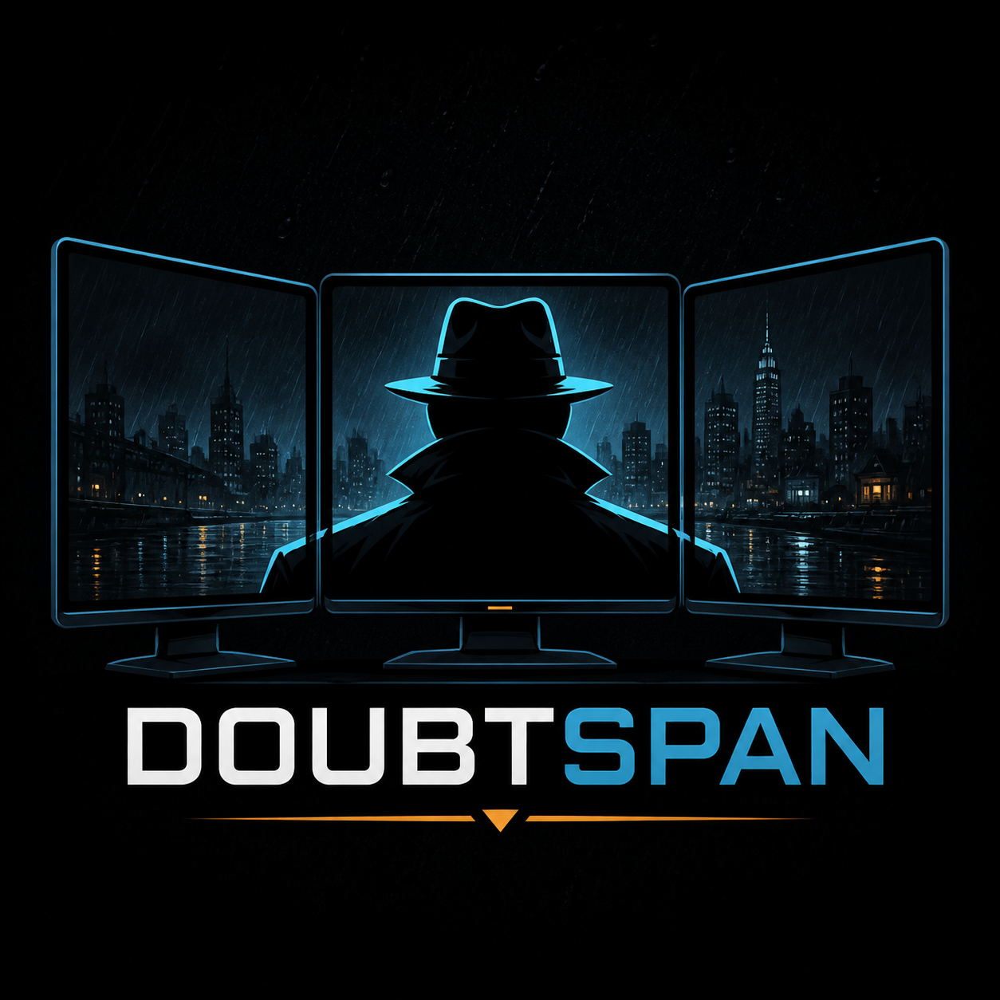

<p align="center">
  
</p>

# DoubtSpan

**DoubtSpan** is an external Windows launcher that runs **Shadows of Doubt**
across three independent monitors with different physical resolutions — no
NVIDIA Surround required.

Tested target:

```text
[ 2560x1440 DSR ][ 2560x1440 native ][ 2560x1440 DSR ]
                         = 7680x1440
```

The 1080p side panels remain physically 1080p. NVIDIA DSR/DLDSR renders them at
an effective 2560x1440 and downsamples the image to each panel.

## What it does

- detects the three-monitor row around the primary display;
- selects an existing DSR/DLDSR 2560x1440 mode on each 1080p side panel;
- backs up the current Windows display layout and the game's relevant Unity
  PlayerPrefs;
- starts the installed game in real Windowed mode with its Steam app identity;
- removes the frame and maintains the exact `x=-2560, y=0, 7680x1440` window;
- restores display modes, preferences, and cursor state when the game exits;
- leaves recovery files in `logs` if a run is interrupted.

The launcher watches the window for the whole session because Shadows of Doubt
can reapply its resolution while loading or recreating graphical state.

## Requirements

1. Windows 10 or 11.
2. Centre monitor set as primary at native 2560x1440.
3. Two 1920x1080 side monitors arranged in the same horizontal row.
4. NVIDIA Surround disabled.
5. 2560x1440 exposed on both side monitors through DSR/DLDSR, usually the
   `1.78x` factor.
6. Windows display scaling at 100% on all three monitors.

## Quick start

Close Shadows of Doubt, download or clone the complete repository, keep the
launcher files together, then run:

```text
Run-DoubtSpan.cmd
```

Read-only diagnosis:

```powershell
.\DoubtSpan.ps1 -DryRun
```

If the game is already open and all three monitors are already at the same
effective resolution:

```text
Fix-Current-DoubtSpan-Window.cmd
```

Emergency recovery after an interrupted session:

```text
Restore-DoubtSpan-Desktop.cmd
```

## Safety boundary

DoubtSpan only uses Unity PlayerPrefs, display modes already exposed by the
driver, and normal top-level Windows APIs. It does not inject DLLs, access game
memory, hook the renderer, modify the game executable, or bypass any security
system.

## Known limitations

- This is one 48:9 surface, not three independent cameras. Peripheral geometry
  and HUD placement depend on the game.
- 7680x1440 is roughly 11.1 million pixels per frame. DLSS or reduced rain and
  light settings may be necessary.
- Other monitor layouts can be configured in `DoubtSpan.ini`, but the tested
  default is the 1440p-centre plus two 1080p-side topology above.

## Related projects

- [Star Citizen Triple Screen](https://github.com/hubertdungen/star-citizen-triple-screen)
- [War Thunder Triple Screen](https://github.com/hubertdungen/war-thunder-triple-screen)
- [X4 Triple Screen](https://github.com/hubertdungen/x4-triple-screen)

## Disclaimer

DoubtSpan is an unofficial community project and is not affiliated with or
endorsed by ColePowered Games, Fireshine Games, Valve, or NVIDIA. Shadows of
Doubt and related names are trademarks of their respective owners.

Licensed under the [MIT License](LICENSE).


<p align="center"><a href="https://dlforge.dungenlabs.com"><picture><source media="(prefers-color-scheme: dark)" srcset="docs/branding/dlforge-logo-negative.svg"></picture></a></p>
